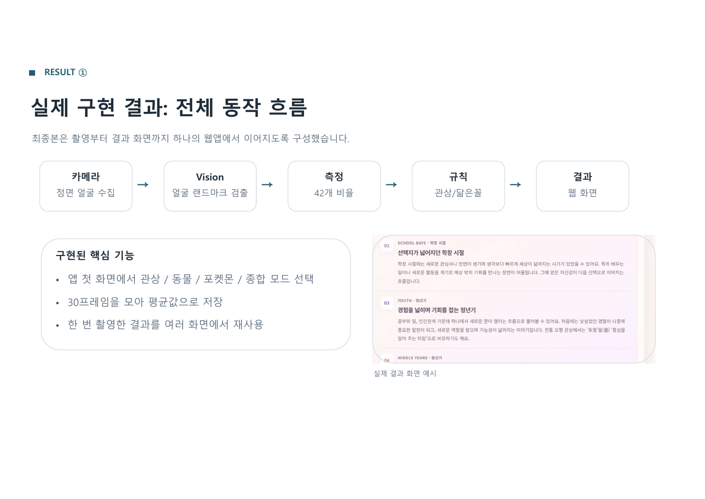
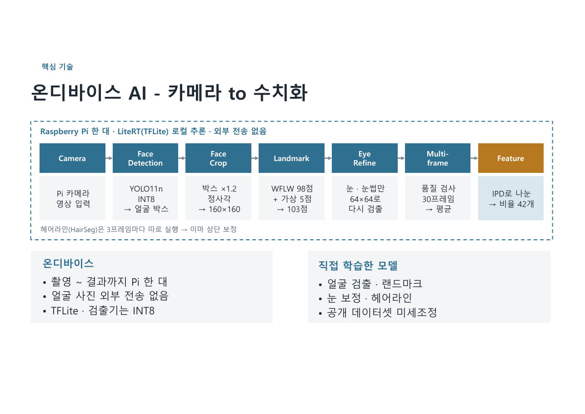
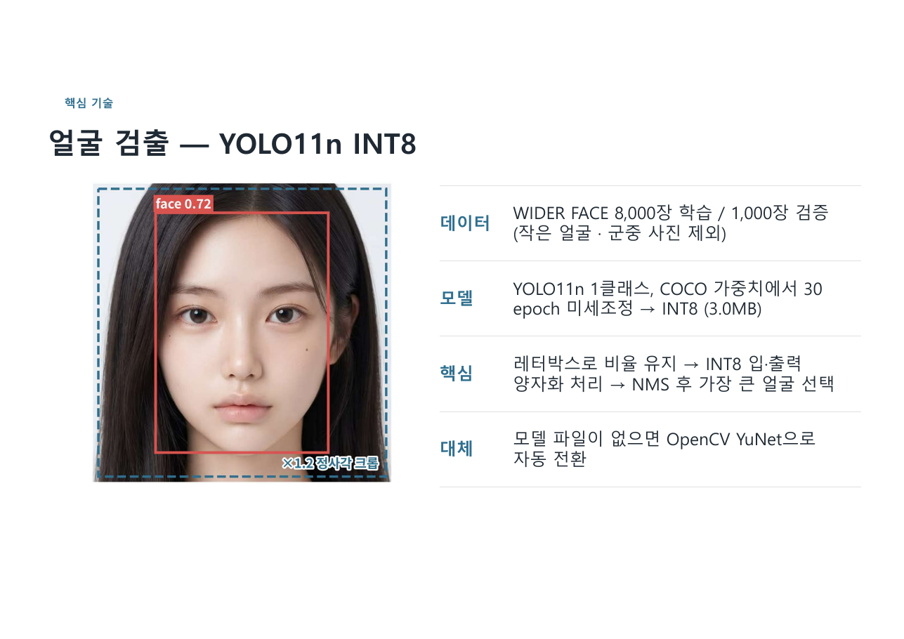
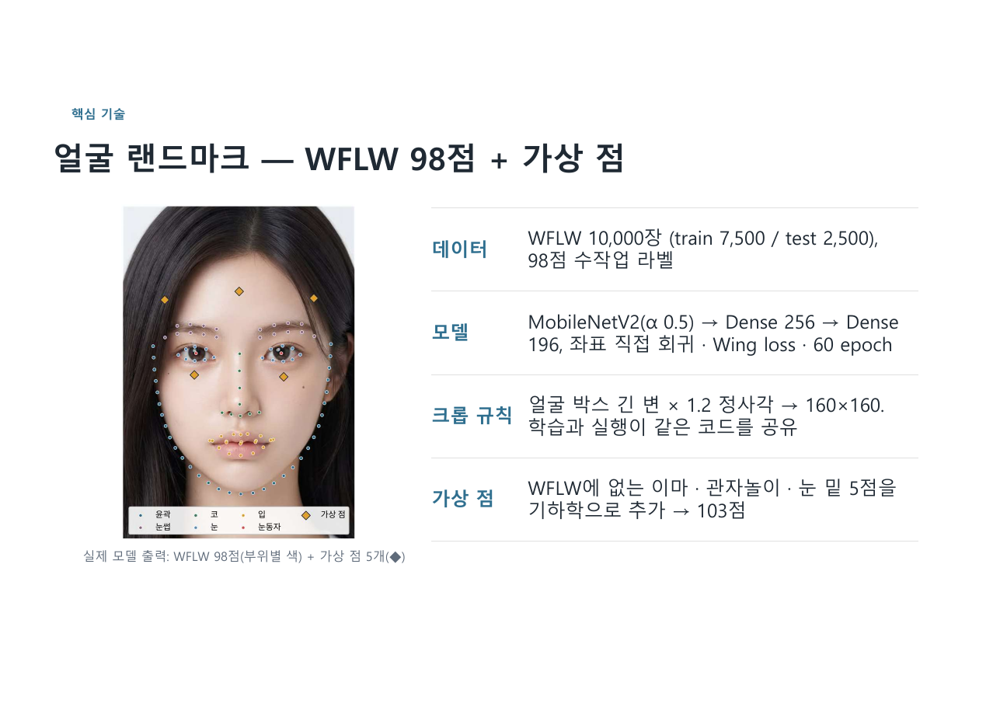
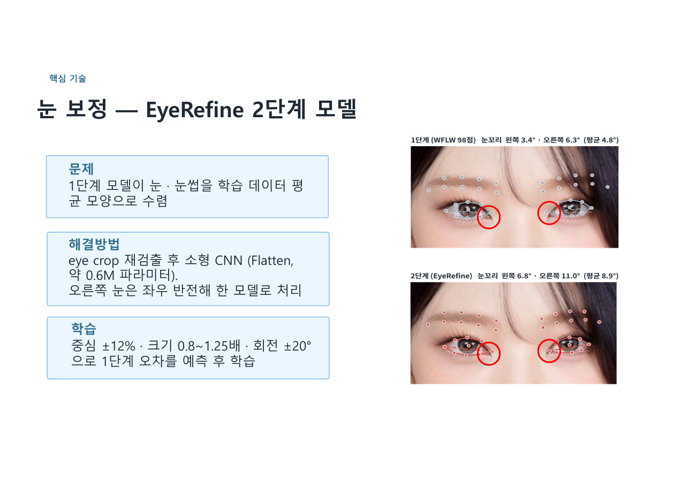
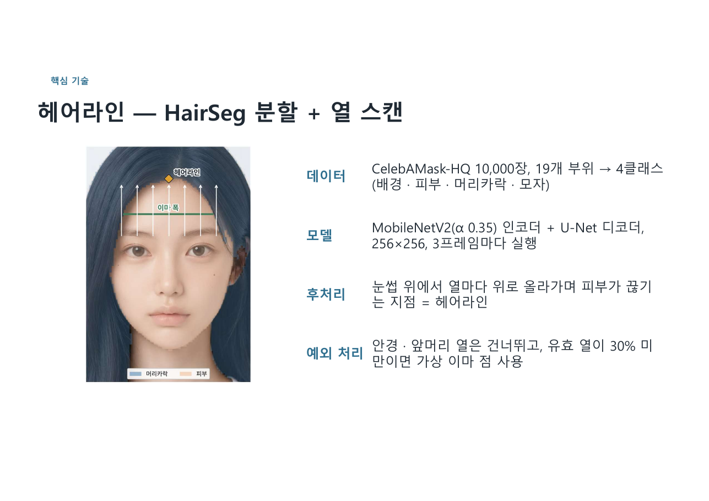
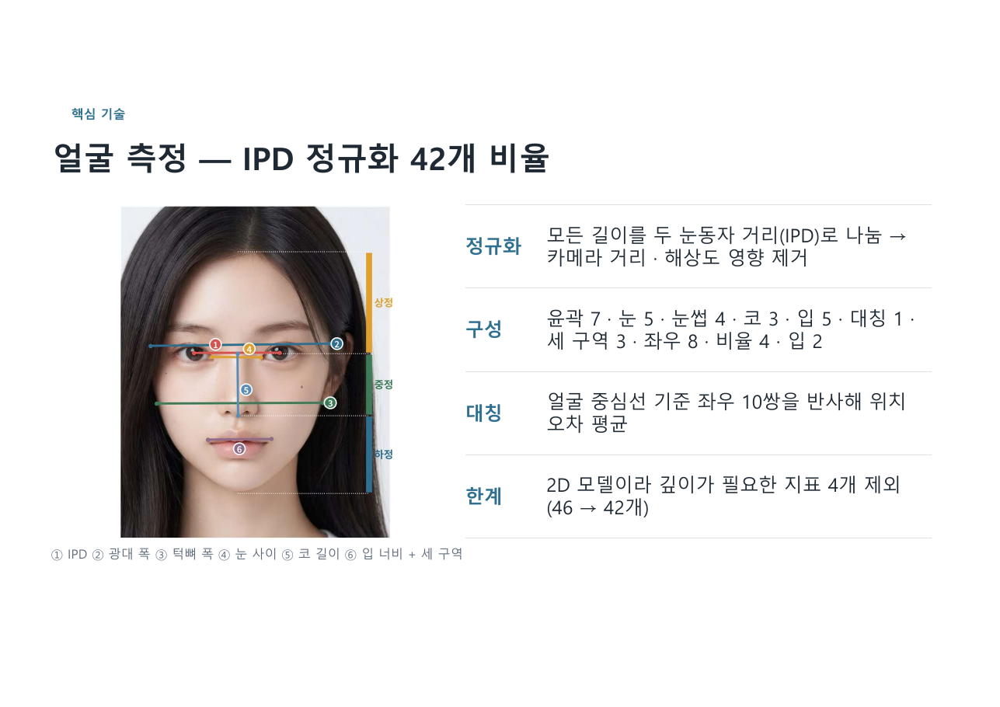
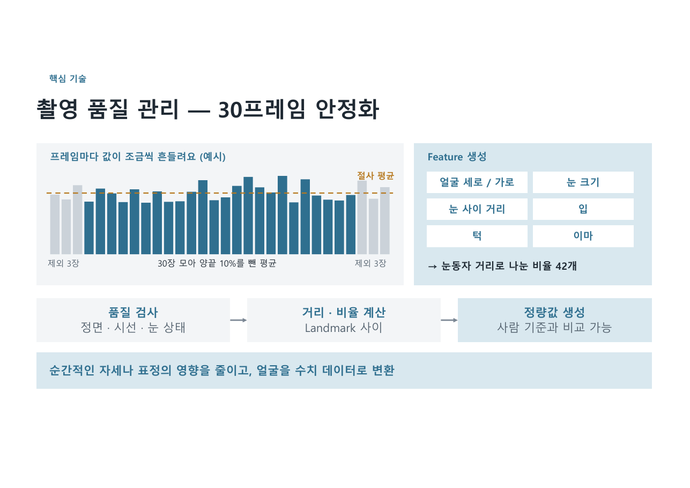
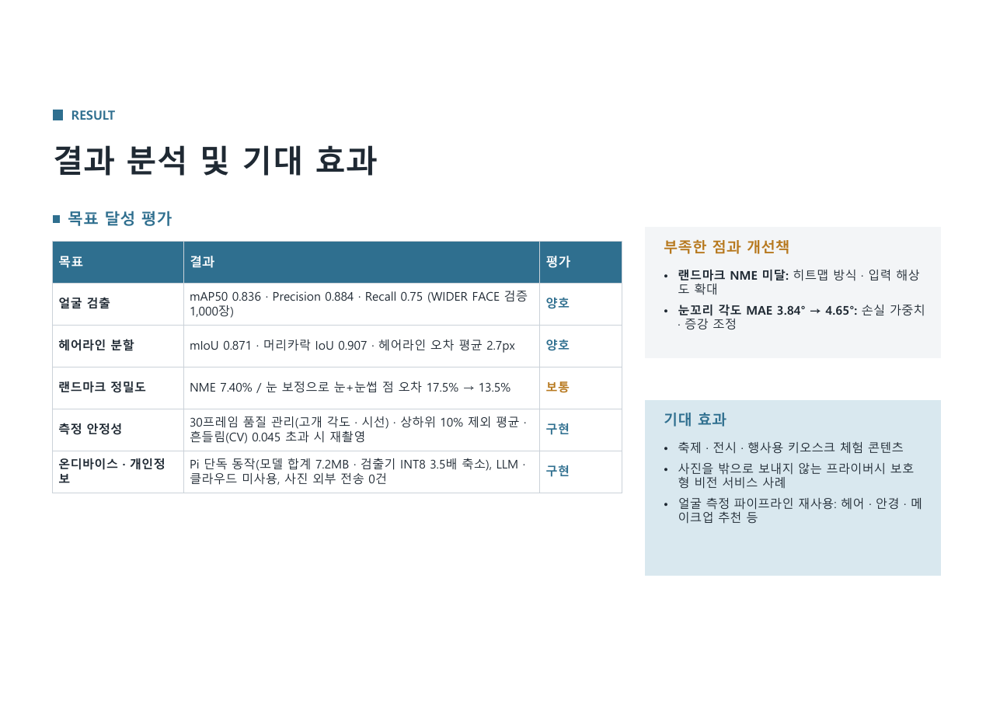

# Face Fortune — Raspberry Pi 온디바이스 얼굴 분석

카메라 영상에서 얼굴을 검출 · 측정해 **42개 얼굴 비율**로 수치화하고, 이를 관상 · 닮은 동물 · 포켓몬 · 종합 4가지 모드 결과로 보여주는 서비스입니다.
얼굴 사진을 서버나 LLM으로 보내지 않고 **Raspberry Pi 한 대에서 모든 추론**을 합니다.
4인 팀 프로젝트(2026.09.30 ~ 10.07) 중 **카메라 영상을 수치로 바꾸는 비전 파이프라인**(모델 4개 학습 · 경량화, 측정, 품질 관리)을 맡았습니다.

| 항목 | 내용 |
| --- | --- |
| 내 담당 | 얼굴 검출 · 랜드마크 · 헤어라인 분할 · 눈 보정 모델 학습과 TFLite 변환, 42개 비율 측정, 30프레임 촬영 품질 관리 |
| 얼굴 검출 | YOLO11n INT8 (3.0 MB) — mAP50 0.836 · Precision 0.884 · Recall 0.75 |
| 헤어라인 분할 | MobileNetV2 + U-Net — mIoU 0.871, 머리카락 IoU 0.907, 헤어라인 오차 평균 2.7 px |
| 랜드마크 · 눈 보정 | WFLW 98점 회귀 NME 7.40%, 2단계 눈 보정으로 눈+눈썹 점 오차 17.5% → 13.5% |
| 측정 안정화 | 조건 통과 30프레임 절사 평균, 흔들림(CV) 0.045 초과 시 재촬영 |
| 온디바이스 | 모델 합계 7.2 MB, Raspberry Pi 5 단독 동작, 사진 외부 전송 0건 |
| 도구 | Python, TensorFlow/Keras, LiteRT(TFLite), Ultralytics YOLO11n, OpenCV, Colab(학습) |

파일별 작성자는 [CONTRIBUTIONS.md](CONTRIBUTIONS.md)에 정리했습니다.

## 전체 흐름



카메라 → **검출 → 랜드마크 → 눈 보정 → 헤어라인 → 품질 검사 · 30프레임 평균 → 42개 비율** (여기까지 담당) → 기준표 비교 · 관상 규칙 · 동물상 CNN(팀원) → 웹 화면



## 비전 파이프라인 설계 (김진환) — `src/face_fortune.py`

### 1. 얼굴 검출 — YOLO11n INT8 (`YoloFaceDetector`, `training/FaceDet_Train.ipynb`)



- WIDER FACE 8,000장(검증 1,000장, 작은 얼굴 · 군중 사진 제외)으로 YOLO11n 1클래스 모델을 30 epoch 미세조정하고 INT8로 양자화했습니다 (3.0 MB).
- 레터박스로 비율을 유지한 입력 → INT8 입 · 출력 양자화 처리 → NMS → 가장 큰 얼굴 선택.
- 모델 파일이 없으면 OpenCV YuNet으로 자동 전환합니다.

### 2. 랜드마크 — WFLW 98점 + 가상 5점 (`WflwMesh`, `training/WFLW_Train.ipynb`)



- MobileNetV2(α 0.5) → Dense 256 → Dense 196 으로 98점 좌표를 직접 회귀, Wing loss · 60 epoch (WFLW 10,000장: 학습 7,500 · 테스트 2,500).
- 얼굴 박스 긴 변 × 1.2 정사각 → 160 × 160 크롭 규칙을 **학습과 실행이 같은 코드로 공유**해 전처리 불일치를 막았습니다.
- WFLW에 없는 이마 · 관자놀이 · 눈 밑 5점을 기하학으로 추가해 103점으로 확장했습니다 (`add_virtual_points`).

### 3. 눈 보정 — 2단계 모델 (`EyeRefiner`, `training/EyeRefine_Train.ipynb`)



- **문제**: 1단계 모델이 눈 · 눈썹을 학습 데이터의 평균 모양으로 그려, 사람마다 다른 눈 모양이 측정에 반영되지 않았습니다.
- **해결**: 눈 영역을 다시 잘라(64 × 64) 소형 CNN으로 재검출합니다. 위치 정보를 지키려고 GAP 대신 Flatten을 썼고(약 0.6M 파라미터), 오른쪽 눈은 좌우 반전해 한 모델로 처리합니다. 1단계 오차를 흉내 낸 증강(중심 ±12%, 크기 0.8 ~ 1.25배, 회전 ±20°)으로 학습했습니다.
- **결과**: 눈+눈썹 18점 오차 17.5% → 13.5%.

### 4. 헤어라인 분할 (`Segmenter` · `Hairline`, `training/HairSeg_Train.ipynb`)



- **문제**: 랜드마크에 이마 윗부분 점이 없어 얼굴 세 구역(상 · 중 · 하안부) 비율을 잴 수 없었습니다.
- **해결**: CelebAMask-HQ 10,000장의 19개 부위를 4클래스(배경 · 피부 · 머리카락 · 모자)로 묶어 MobileNetV2(α 0.35) + U-Net(256 × 256) 분할 모델을 학습했습니다. 눈썹 위에서 열마다 위로 올라가며 피부가 끊기는 지점을 헤어라인으로 잡고, 안경 · 앞머리 열은 건너뜁니다. 유효 열이 30% 미만이면 가상 이마 점을 씁니다.
- **결과**: mIoU 0.871, 헤어라인 오차 평균 2.7 px. 무거운 모델이라 3프레임에 한 번만 실행합니다.

### 5. 42개 비율 측정 (`compute_metrics`)



- 모든 길이를 **두 눈동자 사이 거리(IPD)로 나눠** 카메라 거리 · 해상도 영향을 없앴습니다.
- 윤곽 7 · 눈 5 · 눈썹 4 · 코 3 · 입 5 · 대칭 1 · 세 구역 3 · 좌우 8 · 비율 4 · 입 2 = 42개.
- 대칭은 얼굴 중심선 기준 좌우 10쌍을 반사해 위치 오차를 평균합니다.
- 2D 모델로는 깊이가 필요한 지표 4개를 믿을 수 없어 제외했습니다 (46 → 42).

### 6. 30프레임 품질 관리 (`Measurement`)



- **문제**: 같은 사람도 촬영할 때마다 측정값이 달라졌습니다.
- **해결**: 아래 조건을 모두 통과한 프레임만 30장 모으고, 지표마다 상하위 10%를 뺀 **절사 평균**을 냅니다.

| 조건 | 기준 |
| --- | --- |
| 얼굴 크기 | 광대 폭 ≥ 화면 폭의 22% |
| 정면 | 좌우 회전 비율 ≤ 0.12, 기울기 ≤ 10°, 고개 숙임 · 들림 비율 0.30 ~ 0.56 |
| 시선 | 눈동자가 눈 가로 40 ~ 60%, 세로 30 ~ 70% 안 (렌즈를 보고 있음) |
| 눈 뜸 | 눈 세로/가로 ≥ 0.15 |
| 흔들림 | 얼굴 중심 이동 ≤ 화면 폭 8%, 모은 값의 변동계수(CV) 평균 ≤ 0.045. 넘으면 재촬영 |

## 결과



| 목표 | 결과 | 평가 |
| --- | --- | --- |
| 얼굴 검출 | mAP50 0.836 · Precision 0.884 · Recall 0.75 (WIDER FACE 검증 1,000장) | 양호 |
| 헤어라인 분할 | mIoU 0.871 · 머리카락 IoU 0.907 · 헤어라인 오차 2.7 px | 양호 |
| 랜드마크 | NME 7.40%, 눈 보정 후 눈+눈썹 오차 17.5% → 13.5% | 보통 (목표 6% 미달) |
| 온디바이스 | 모델 합계 7.2 MB (검출기 INT8로 3.5배 축소), LLM · 클라우드 미사용 | 구현 |

## 실행 방법

학습된 모델(.tflite)과 결과 화면용 이미지는 용량 · 저작권 문제로 저장소에 넣지 않았습니다. `training/` 노트북(Colab)으로 모델을 만든 뒤 `src/` 에 넣어 실행합니다.

| 노트북 | 출력 모델 |
| --- | --- |
| FaceDet_Train.ipynb | face_det_int8.tflite |
| WFLW_Train.ipynb | wflw_mesh.tflite |
| EyeRefine_Train.ipynb | eye_refine.tflite |
| HairSeg_Train.ipynb | hair_seg.tflite |
| Norms_Train.ipynb | 얼굴형 분류 MLP · 측정 기준 분포 |

```bash
# Raspberry Pi 5, Debian 12, Python 3.11, USB 카메라
python3 -m venv infer_env && source infer_env/bin/activate
pip install numpy opencv-python ai-edge-litert flask
cd src
python face_fortune.py --camera 1                                # 측정 화면 (OpenCV 창)
python web_app.py --camera 1 --host 0.0.0.0 --port 5000          # 전체 웹앱 → http://<Pi IP>:5000
```

주의: `face_fortune.py` 가 동물상 모듈(`run_team_animal_test.py`)을 import 하므로, 측정만 돌릴 때도 팀원이 만든 `animal_pokemon_final/` 폴더(동물상 모델 · 스크립트, 저장소 미포함)가 `src/` 안에 있어야 실행됩니다.

`face_fortune.py` 는 `--no-hairline`, `--no-eye-refine` 옵션으로 각 모델을 끄고 비교할 수 있습니다.

## 폴더 구조

```
src/face_fortune.py   비전 파이프라인 (검출 · 랜드마크 · 눈 보정 · 헤어라인 · 측정 · 품질 관리)
src/                  웹앱 · 관상 해석 · 동물상 매칭 (팀원)
training/             모델 학습 노트북 5개와 전처리 코드
docs/img/             구조도, 결과 자료
```

## 팀

| 이름 | 담당 |
| --- | --- |
| **김진환** | **비전 파이프라인 (모델 4개 학습 · 경량화, 42개 비율 측정, 품질 관리)** |
| 김도현 · 김민선 · 설재광 | 기준표 · 관상 해석, 동물상 · 포켓몬 매칭, 웹앱 · UI (세부 담당 확인 필요) |

## 한계 및 개선 방향

| 구분 | 현재 상태 | 개선 방향 |
| --- | --- | --- |
| 랜드마크 정밀도 | NME 7.40%로 목표(6%) 미달. 좌표 직접 회귀 방식의 한계 | 히트맵 방식으로 전환, 입력 해상도 확대 |
| 눈 보정의 부작용 | 점 오차는 23% 줄었지만 눈꼬리 각도 오차(MAE)는 3.84° → 4.65°로 오히려 증가 | 각도 항을 손실에 추가하고 증강 범위 조정. 지표 하나가 아니라 실제 쓰는 값으로 평가 |
| 2D 측정 한계 | 깊이가 필요한 지표 4개 제외 | 깊이 추정 모델 또는 정면 · 측면 2장 촬영 |
| 견고성 평가 부족 | 조명 · 안경 · 고개 각도별, 성별 · 연령별 편향 미평가 | 조건별 테스트셋 구성, Pi 실기기 정확도 · 속도 · 재촬영 일치율 측정 |
| 개인정보 | 사진은 Pi 밖으로 나가지 않지만 HTTP · 캡처 저장 | HTTPS 적용, 분석 후 사진 자동 삭제 |
| 모듈 결합 | 측정 파이프라인(`face_fortune.py`)이 동물상 모듈을 파일 맨 위에서 import 해, 측정만 따로 실행 · 테스트할 수 없음 | 측정과 결과 해석을 별도 패키지로 나누고, 동물상 모듈은 필요할 때만 불러오기 |
